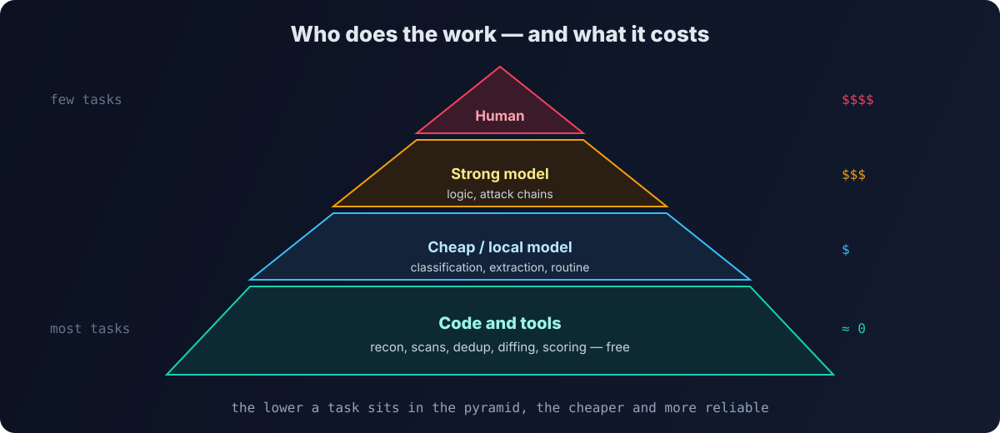

Когда я начал встраивать AI-агентов в свою платформу для bug bounty [Qyran](/blog/qyran/), первым шоком был не интеллект моделей, а счета. Агент, которому дали «просто проверить сайт», с удовольствием читает мегабайты логов, по десять раз перезапускает одни и те же команды и тащит в каждый запрос всю историю диалога. Подписки на топовые модели стоят порядка $200 в месяц, а оплата по API без контроля улетает ещё быстрее.

В итоге полное сканирование цели в Qyran обходится **примерно в доллар**. Ниже — принципы, которые к этому привели.

## 1. Всё, что можно сделать кодом, — делать кодом

Главный принцип. Разведка поддоменов, проверка живости хостов, сбор технологий, сканирование портов, дедупликация, сравнение с прошлым запуском — это детерминированные задачи. Их выполняет обычный код и инструменты, **бесплатно и одинаково каждый раз**.

Агент не должен «запускать subfinder и читать вывод». Он должен получать **уже собранную и очищенную таблицу активов** и решать, куда копать. Каждая операция, которую вы переложили с модели на код, экономит токены и делает результат воспроизводимым.

## 2. Модель — под задачу, а не одна на всё

Задачи у агентов очень разные:

| Задача | Что нужно от модели | Какую брать |
|---|---|---|
| классификация, сортировка, извлечение полей | дисциплина, формат | дешёвая и быстрая |
| разбор находки, написание шаблона проверки | понимание кода и протоколов | средняя, сильная в коде |
| бизнес-логика, цепочки атак, сложный анализ | рассуждение | сильная |
| приватные данные, рутина без спешки | конфиденциальность | [локальная](/blog/ollama-open-webui/) |

Ядро AI-слоя Qyran построено на opencode, который позволяет подключать разных провайдеров и **назначать разным агентам разные модели**. Оркестратор и скептик-верификатор получают модель посильнее, рутинные агенты — дешёвую. По моим замерам лучшим соотношением цены и качества для основной работы оказалась одна из моделей DeepSeek; цены и рейтинги меняются каждые пару месяцев, поэтому выбор стоит пересматривать.

## 3. Короткий контекст — главная статья экономии

Большая часть денег уходит не на ответы, а на **входные токены**: системные промпты, история диалога, вывод инструментов.

- **Не отдавайте сырой вывод.** Вместо 50 тысяч строк из лога — агрегат: «топ-20 эндпоинтов с ошибкой 500». Подготовку делает код.
- **Навыки подгружаются по требованию.** В Qyran 120+ методик, но агент не держит их все в контексте — он загружает только ту, что нужна для задачи.
- **Новая задача — новая сессия.** Длинная переписка тащит за собой всю историю. Итоги сессии лучше сохранить в короткую заметку и начать заново.
- **Пользуйтесь кэшированием промптов** у провайдера: повторяющийся префикс (инструкции, навыки) стоит заметно дешевле.

## 4. У автономной работы должен быть бюджет

Автономный агент без ограничений — это открытый кошелёк. В Qyran автономная работа идёт **сменами**:

- у смены есть **дедлайн и лимит стоимости**; при достижении любого — остановка и передача дел;
- стоимость синхронизируется по ходу работы, а не считается постфактум;
- **watchdog** следит за зациклившимися и зависшими агентами;
- **журнал покрытия** показывает, что уже проверено, — агент не повторяет одни и те же проверки.

Даже без своей платформы этот принцип легко применить: лимиты расходов в кабинете провайдера, отдельные ключи API под разные задачи и ежедневная проверка трат.

## 5. Не будите агента без дела

Периодические «пинги», проверки состояния и heartbeat-запросы к дорогой модели незаметно съедают деньги каждый день. Такие вещи должен делать код или самая дешёвая модель, а дорогая — подключаться только когда есть реальная работа.

## 6. Измеряйте стоимость единицы работы

«Сколько стоит одно сканирование», «сколько стоит разбор одной находки» — эти числа нужно знать. Без них невозможно понять, помогла ли оптимизация. После того как я начал считать стоимость сканирования, стало видно, какие агенты и стадии тратят больше всего, — и туда я направлял оптимизацию.

## Итог

| Было | Стало |
|---|---|
| агент сам запускает инструменты и читает их вывод | код собирает и очищает данные, агент анализирует |
| одна дорогая модель на всё | модель под задачу, локальная для приватного |
| вся история в каждом запросе | короткие сессии, навыки по требованию, кэш |
| «пусть работает, пока не найдёт» | смены с дедлайном и бюджетом |

ИИ — мощный компонент, но не единственный. Чем больше рутины забирает код, тем дешевле и надёжнее работают агенты.
