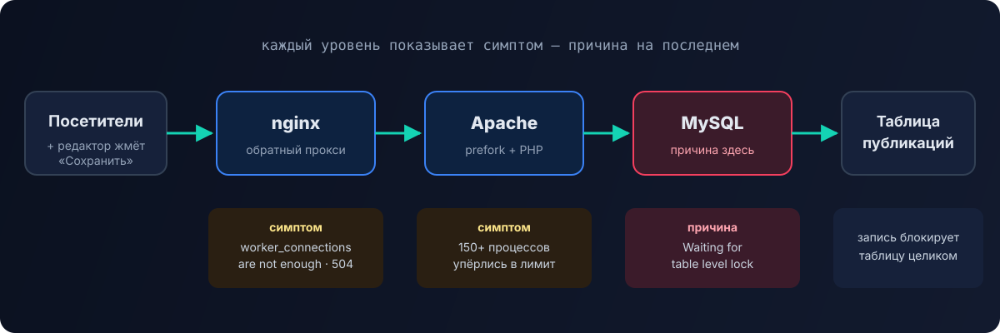

This was my first properly documented performance case — in a way, it's where this blog started. A customer ordered paid administration work on their cloud server. All data is anonymized: the names of the site, the server and the database are changed.

## Starting point

| Parameter | Value |
|---|---|
| Server | cloud VPS, 2 vCPU, 8 GB RAM |
| OS | Ubuntu 22.04 |
| Panel | ISPmanager |
| Stack | nginx → Apache (prefork) → PHP → MySQL 8 |
| Cache | Redis, OPcache |
| Site | a news portal on DLE, tens of thousands of posts with audio |

**The complaint:** the moment a post is saved, the number of processes spikes, CPU and memory max out, the site returns `504 Gateway Time-Out`, and only a forced reboot helps.

The customer first went to the CMS developers. Their answer was logical but useless: "when saving, DLE resets its caches, load goes up, and server tuning is the hosting provider's job." That's how the task reached me.

## Step 1. Reproduce the problem

Without reproduction you can tweak settings blindly forever. I asked the customer to create a test post and send me the files editors usually work with. The result: **any edit** of a post with audio triggered an avalanche — the number of Apache processes grew nonstop until the server hung.

Now there was something to measure.



## Step 2. nginx: not enough connections

nginx is first in the chain, so I started with its logs:

```text
[alert] 768 worker_connections are not enough
```

The default 768 connections per worker weren't enough. I raised the limit and set up buffering of backend responses:

```nginx
events {
    worker_connections 4096;
}

# in the http / server block
proxy_buffering on;
proxy_buffer_size 4k;
proxy_buffers 32 4k;
proxy_max_temp_file_size 0;
```

The errors went away, but the site still went down — nginx was simply passing the jam further along.

## Step 3. Apache: processes hit the limit

The next level is Apache in prefork mode, where each request takes a separate process. The customer saw more than 150 `apache2` processes — exactly as many as the limit allowed. New requests queued up, nginx didn't wait for a response and returned 504.

I raised the limits in `/etc/apache2/mods-available/mpm_prefork.conf`:

```apache
StartServers            10
MinSpareServers         10
MaxSpareServers         20
ServerLimit             2000
MaxRequestWorkers       1500
MaxConnectionsPerChild  10000
```

`MaxConnectionsPerChild` recycles a process after 10,000 requests, which protects against PHP memory leaks.

After that the processes stopped hitting the ceiling, and **the whole load moved to the database**. That's an important point: raising limits doesn't solve the problem, it moves it to the next level. But now you could see where it really was.

## Step 4. MySQL: a queue of locks

`SHOW PROCESSLIST` showed a picture that explained everything:

```text
| Id   | db      | Command | Time | State                        | Info                      |
| 6294 | site_db | Query   |   46 | Waiting for table level lock | SELECT p.id, p.autor, ... |
| 6295 | site_db | Query   |   29 | Waiting for table level lock | SELECT p.id, p.autor, ... |
| 6296 | site_db | Query   |   26 | Waiting for table level lock | SELECT p.id, p.autor, ... |
| 6303 | site_db | Query   |   73 | executing                    | SELECT p.id, p.autor, ... |
...
```

Dozens of identical `SELECT`s against the posts table sat in **`Waiting for table level lock`** for 30–70 seconds. The mechanics of the jam:

1. An editor saves a post — the CMS writes to the posts table and resets its cache.
2. The write locks **the whole table**.
3. The cache is gone, so every visitor goes straight to the database — and queues up behind the lock.
4. Every waiting query holds an Apache process — processes multiply, memory runs out, the server falls over.

To find out which queries were to blame, I enabled the slow query log and analyzed it with `pt-query-digest` from Percona Toolkit:

```text
# Overall: 811 total, 23 unique, 1.08 QPS, 88.99x concurrency
# Attribute          total     min     max     avg     95%
# Exec time         66652s      2s    168s     82s    159s
# Lock time         44917s       0    159s     55s    151s

# Rank Response time     Calls R/Call   Item
#    1 31009.2  46.5%      282 109.96   SELECT dle_post dle_post_extras
#    2 18449.6  27.7%      167 110.48   SELECT dle_post dle_post_extras dle_post_extras_cats
#    3  7528.1  11.3%       93  80.95   SELECT dle_post dle_post_extras_cats dle_post_extras
```

The key numbers: the average query took **82 seconds**, of which **55 seconds was waiting for a lock**. A concurrency of 89x means about 90 queries were waiting at the same time. The problem wasn't "heavy" queries — it was that they **waited for each other**.

## Step 5. MySQL configuration

The MySQL config was almost stock, sized for minimal hardware. I brought it in line with an 8 GB server where the database is the main memory consumer:

```ini
[mysqld]
# InnoDB: keep data and indexes in memory
innodb_buffer_pool_size      = 4G
innodb_buffer_pool_instances = 4
innodb_log_file_size         = 1G
innodb_flush_method          = O_DIRECT
innodb_read_io_threads       = 8
innodb_write_io_threads      = 8
innodb_lock_wait_timeout     = 50

# Caches and buffers
key_buffer_size    = 64M
table_open_cache   = 2000
sort_buffer_size   = 4M
thread_cache_size  = 100

# Connections
max_connections     = 300
wait_timeout        = 120
interactive_timeout = 120

# Diagnostics
slow_query_log                = 1
slow_query_log_file           = /var/log/mysql/mysql-slow.log
long_query_time               = 1
log_queries_not_using_indexes = 1
```

What matters most here:

| Setting | Why |
|---|---|
| `innodb_buffer_pool_size = 4G` | half the RAM for caching data and indexes: queries read from memory, not disk |
| `innodb_flush_method = O_DIRECT` | no double caching in InnoDB and the OS page cache |
| `innodb_log_file_size = 1G` | fewer log flushes on writes |
| `table_open_cache`, `thread_cache_size` | less overhead opening tables and creating threads |
| `max_connections = 300` | a limit consistent with memory: every connection uses RAM too |
| `slow_query_log` | ongoing monitoring so the next problem is visible right away |

Along the way I removed the `query_cache_*` settings from the config — the query cache is gone in MySQL 8, and such lines stop the server from starting.

## Result

After the changes the avalanche on post save disappeared. `SHOW PROCESSLIST` during an edit showed a few idle service connections and not a single lock wait. A fresh slow log analysis:


| Metric | Before | After |
|---|---|---|
| Average query time | 82 s | 13 ms |
| Average lock wait | 55 s | 2 µs |
| Concurrency | 89x | 0.01x |
| Queries in the slow log over ~10 minutes | 811 | 278 |

Most queries now run in 100 µs – 1 ms. Some slow queries remained — for example, a selection with `NOT IN (subquery)` sorted by view count that examines 228 thousand rows — but they no longer block the whole site.

## What I'd do differently today

This was my first serious performance investigation. Rereading it later, I can see what could have been done better:

- **Check the table engine right away.** `Waiting for table level lock` is the classic sign of **MyISAM** tables: they lock entirely on any write. InnoDB locks only the rows it needs. Checking takes one query:

  ```sql
  SELECT TABLE_NAME, ENGINE FROM information_schema.TABLES
  WHERE TABLE_SCHEMA = 'site_db' AND ENGINE <> 'InnoDB';
  ```

  Converting old tables to InnoDB (`ALTER TABLE … ENGINE=InnoDB`, after a backup) addresses this root cause rather than its symptoms.

- **Be careful with Apache limits.** `MaxRequestWorkers 1500` on an 8 GB server bets on processes staying light. A prefork process with PHP takes tens of megabytes, and in the next jam such a limit can eat all the memory. It's better to size the limit from memory — and better still to move to PHP-FPM and `mpm_event`.

- **Don't forget the application cache.** The jam started because after a post was saved, every visitor hit the database at once. Page caching at the nginx or Redis level smooths out such spikes.

- **Add indexes for the slow queries.** The remaining slow selections are candidates for indexes and an `EXPLAIN` review.

## Lessons

1. **Reproduce first, tune second.** A test post from the customer saved days of guesswork.
2. **Follow the request chain.** nginx → Apache → PHP → MySQL: each level shows a symptom, the cause is at the end.
3. **Raising limits moves the problem rather than solving it.** But it shows where the real bottleneck is.
4. **Measure before and after.** Without `pt-query-digest`, "it got better" would just be a feeling.
