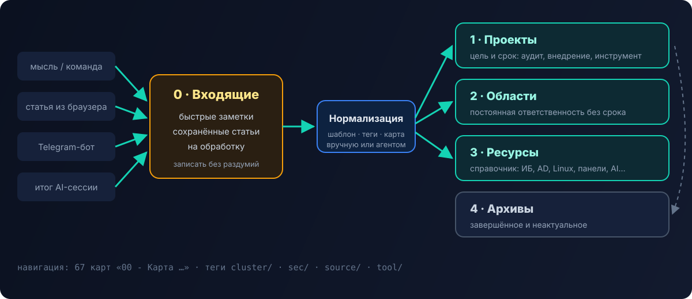

Почти все статьи этого блога выросли из моих заметок. Я пришёл в хостинг-компанию системным администратором первой линии и с первого дня записывал всё: команды, разборы инцидентов, решения тикетов, конспекты курсов. Потом добавились ИБ, Active Directory, SIEM, bug bounty. Сейчас в хранилище **около 4800 заметок** — и найти нужную занимает секунды. Над структурой я работал месяцами, переделывая её несколько раз.

## Почему PARA

Метод **PARA** (Тьяго Форте) делит всё на четыре группы по **степени активности**, а не по теме:

- **Projects / Проекты** — то, что имеет цель и срок: аудит, внедрение, разработка инструмента;
- **Areas / Области** — зоны постоянной ответственности без срока: работа, обучение, здоровье;
- **Resources / Ресурсы** — справочник по темам: всё, что может пригодиться;
- **Archives / Архивы** — завершённое и неактуальное.

Главная идея — заметка «переезжает» по мере жизни: материал из ресурсов становится частью проекта, проект после завершения уходит в архив. Структура отражает, **чем ты занят сейчас**, а не пытается построить идеальную энциклопедию.

## Моя версия: входящий буфер + PARA на русском

Я назвал папки по-русски и добавил нулевой уровень — **Входящие**. Это оказалось самым важным изменением.



```text
0 - Входящие/
    0 - Быстрые заметки/      ← мысль, команда, ссылка «на бегу»
    1 - Сохраненные статьи/   ← клиппинги из браузера и Telegram
    3 - На обработку/         ← ждёт разбора и нормализации
1 - Проекты/
2 - Области/
3 - Ресурсы/
4 - Архивы/
Templates/
```

Зачем буфер: когда записываешь что-то срочно, думать «куда это положить» — лишнее трение. Поэтому всё новое падает во входящие, а раскладка — отдельный процесс, раз в несколько дней. Без буфера через месяц половина заметок лежит не там, где её будут искать.

**Ресурсы** — самая большая часть. Внутри они разбиты по крупным темам: системное администрирование и DevOps, ИБ, Active Directory, хостинг-панели, сети, программирование, AI. В каждой теме — свои подпапки, например «Ollama (Локальная нейросеть)» или «Plesk» с разделами по базам, почте, бэкапам.

## Карты разделов вместо иерархии

Папки хороши для хранения, но плохи для навигации: заметка может относиться сразу к нескольким темам. Поэтому у каждого крупного раздела есть **карта** — заметка `00 - Карта …` (MOC, Map of Content). Ноль в начале держит её первой в списке.

Карта — это не автоматическое оглавление, а **осмысленная навигация**: с чего начать, какие заметки ключевые, что связано с чем. Сейчас у меня **67 карт**. Когда раздел разрастается, сначала появляется карта, а потом — подпапки.

## Теги: кластеры, а не облако

Теги у меня не «#интересное», а **иерархия с префиксами**, у каждой ветки своя роль:

| Тег | Что значит | Пример |
|---|---|---|
| `cluster/...` | тематический кластер, связывает заметки из разных папок | `cluster/security`, `cluster/windows-ad`, `cluster/hosting-panel` |
| `sec/...` | ИБ-разметка: тип материала, техника, инструмент | атаки, защита, расследования |
| `source/...` | откуда пришёл материал | собственный опыт, курс, статья, клиппинг |
| `tool/...` | конкретный инструмент | сканеры, утилиты |

Тег `source` оказался неожиданно полезным: сразу видно, где **мой опыт**, а где — конспект чужого материала. Это пригодилось и для блога — в статьи шёл только собственный опыт, а конспекты чужих туториалов я пересказывал своими словами.

С кластерами работает плагин **Dataview**: карта раздела может сама собирать «все заметки кластера `cluster/hosting-panel`, изменённые за месяц» — список всегда актуален.

## Шаблоны

Через **Templater** у меня шаблоны под повторяющиеся типы заметок:

- **ежедневная заметка** — журнал дня;
- **проект** — канбан с задачами;
- **bug bounty** — структура для цели: скоуп, разведка, находки, отчёт;
- **итог AI-сессии** — что сделано, что решено, что дальше;
- **заметка из Telegram** — для сообщений, пересланных боту.

Шаблон экономит не время на набор, а **решение о структуре**: заметки одного типа выглядят одинаково, их легко сравнивать и обрабатывать автоматически.

## Плагины, которые реально используются

| Плагин | Зачем |
|---|---|
| **Dataview** | запросы к заметкам: живые списки в картах |
| **Templater** | шаблоны с логикой |
| **Obsidian Git** | хранилище в приватном git-репозитории: история и бэкап |
| **Telegram Sync** | переслал сообщение боту — оно уже во входящих |
| **Iconize** | иконки на папках, чтобы глаз быстрее находил раздел |
| **Table Editor** | нормальное редактирование таблиц |
| **Pandoc** | экспорт в docx/pdf для отчётов |
| **Terminal** | терминал прямо в Obsidian |

Принцип: плагин остаётся, только если я пользуюсь им каждую неделю.

## AI-слой: хранилище, которое разбирает себя само

Последний этап — подключение AI-агента прямо к хранилищу. В корне лежит папка с конфигурацией агента:

- **правила хранилища** — как устроены папки, теги, карты и куда что класть;
- **память** — короткий файл с ключевыми фактами (жёсткий лимит по размеру, чтобы не раздувался), плюс текущий фокус;
- **навыки** — нормализация заметок, работа с хранилищем, синхронизация памяти и предметные: bug bounty, аудит серверов, Active Directory, Wazuh;
- **команды** — начало сессии, итог сессии, смена фокуса, нормализация входящих.

Самая полезная команда — **нормализация входящих**. Агент берёт сырую заметку из буфера, приводит к шаблону, проставляет теги `cluster`/`source`, переносит в нужный раздел и добавляет ссылку в карту. То, что раньше было скучным разбором раз в неделю, теперь делается по одной команде. Подробнее об этой связке — в статье [«Второй мозг: Claude, NotebookLM и Obsidian»](/blog/vtoroy-mozg-ai/).

Это же хранилище подключено к моей платформе [Qyran](/blog/qyran/): AI-агенты используют базу методик и пишут туда отчёты.

## Что я вынес за годы

- **Структура должна снижать трение записи.** Если думать «куда положить» — запись не случится. Отсюда входящий буфер.
- **Папки — для хранения, карты и теги — для навигации.**
- **Отмечайте источник.** Через год вы не вспомните, это ваш опыт или пересказ чужой статьи.
- **Разбор — отдельный регулярный процесс**, который можно отдать агенту.
- **Переделывать нормально.** Моя структура менялась несколько раз, и каждый раз становилась проще.

Если коротко: Obsidian — это не про красивый граф связей, а про то, чтобы через три года найти команду, которой ты однажды починил прод в два часа ночи.
