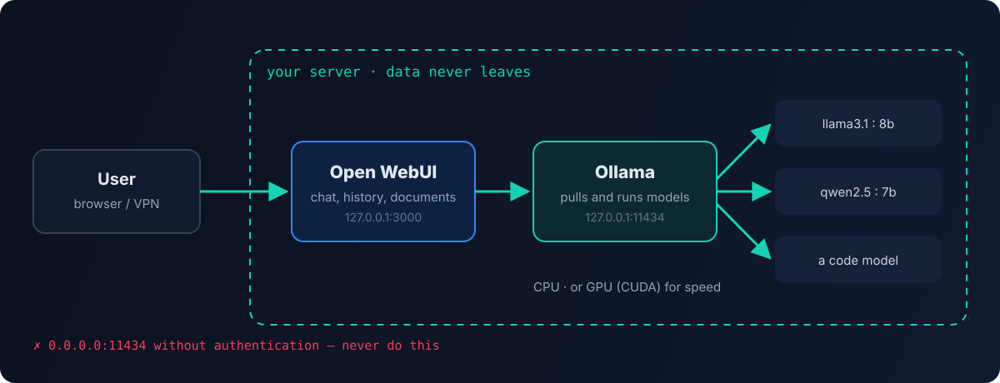

Cloud models are convenient, but in security you constantly deal with things that can't be sent outside: logs, configs, customer data, audit results. For those tasks I keep a **local LLM**: the model runs on my own server, and not a single byte goes to a third-party provider. The setup is simple — **Ollama** runs the models, **Open WebUI** provides a ChatGPT-like web interface.



## Hardware requirements

| What | Minimum |
|---|---|
| OS | Linux, e.g. Ubuntu 22.04+ |
| RAM | ~16 GB for 7–8B models |
| Disk | from 12 GB: Ollama and a couple of base models, then as much as your models need |
| CPU | 4+ cores, 8+ for 13B models |
| GPU | optional, but speeds up generation a lot |

A simple rule of thumb: a quantized 7–8 billion parameter model takes a few gigabytes and works fine even on a CPU. 30B+ models without a GPU with enough VRAM will answer very slowly. If you plan to use a GPU, install the NVIDIA drivers and CUDA first.

## Installing Ollama

The official script installs the binary and the service:

```bash
curl -fsSL https://ollama.com/install.sh | sh
```

If you want your own control over the service — a dedicated user and a unit file:

```bash
sudo useradd -r -s /bin/false -m -d /usr/share/ollama ollama
```

```ini
# /etc/systemd/system/ollama.service
[Unit]
Description=Ollama Service
After=network-online.target

[Service]
ExecStart=/usr/local/bin/ollama serve
User=ollama
Group=ollama
Restart=always
RestartSec=3
Environment="OLLAMA_HOST=127.0.0.1:11434"
# For NVIDIA GPUs — faster generation:
# Environment="OLLAMA_FLASH_ATTENTION=1"

[Install]
WantedBy=default.target
```

```bash
sudo systemctl daemon-reload
sudo systemctl enable --now ollama
ollama --version
```

## Models

```bash
ollama pull llama3.1:8b     # a general-purpose model
ollama pull qwen2.5:7b      # good with Russian and code
ollama list                 # what's downloaded
ollama run llama3.1:8b      # chat right in the terminal
```

How to choose:

- **by task** — for code and configs take code-focused models; for non-English texts, models with strong multilingual support;
- **by hardware** — start with 7–8B and only go bigger if the speed is acceptable;
- **quantization** — `q4`/`q5` versions use several times less memory with a small quality loss.

The model catalog is on the Ollama website, along with the size of each version.

## Open WebUI

The fastest way is the Docker image with Ollama built in:

```bash
# with GPU
docker run -d -p 127.0.0.1:3000:8080 --gpus=all \
  -v ollama:/root/.ollama -v open-webui:/app/backend/data \
  --name open-webui --restart always ghcr.io/open-webui/open-webui:ollama

# CPU only
docker run -d -p 127.0.0.1:3000:8080 \
  -v ollama:/root/.ollama -v open-webui:/app/backend/data \
  --name open-webui --restart always ghcr.io/open-webui/open-webui:ollama
```

If Ollama already runs as a service, use the regular `open-webui:main` image and point it at Ollama with the `OLLAMA_BASE_URL` variable.

The interface opens at `http://127.0.0.1:3000`. The first registered user becomes the administrator — register right after launch.

Besides chat, Open WebUI offers conversation history, multiple models, uploading documents to ask questions about them, users and roles.

## Security — the most important part

The internet is full of guides that run Ollama with `OLLAMA_HOST=0.0.0.0` and `OLLAMA_ORIGINS=*`. Don't do that:

- **The Ollama API has no authentication.** If port `11434` is open to the outside, anyone can use your server and download or delete models. Exposed Ollama instances are found by scanners en masse.
- **Listen on localhost only** or on an internal address behind a VPN. If you need network access, put a reverse proxy with TLS and authentication in front and close the port with a firewall.
- **Open WebUI** should also be published only through a proxy with TLS, and open registration should be disabled once your users are created.
- **`OLLAMA_ORIGINS=*`** allows any website in a browser to call the API — don't enable it unless you need to.

Checking that nothing is exposed:

```bash
ss -tlnp | grep -E '11434|3000'
```

Both ports should listen on `127.0.0.1`, not `0.0.0.0`.

## Where I use it

- analyzing logs and configs that can't be sent to the cloud;
- drafting documentation and instructions from the internal knowledge base;
- agent experiments — a local model as a "free" worker for simple tasks.

Cloud models are still stronger for hard tasks, so I combine them: a local model for private and routine work, a cloud model for heavy analysis. How I choose models and count the money is covered in [Cutting AI agent costs](/en/blog/ai-agent-costs/).
