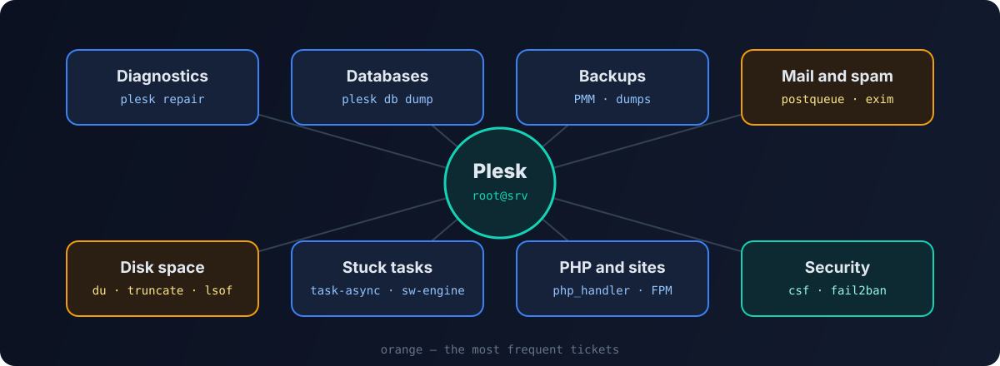

On first- and second-line hosting support, Plesk is everyday work. In my Obsidian vault the Plesk section grew to about fifty notes: from "why isn't mail going out" to attaching a LUN larger than 2 TB. Here is the essence — the commands that actually came in handy most often. All examples are anonymized: `example.com`, `user@example.com`, `ID` — substitute your own.



> Everything below runs as root over SSH. Before any bulk operation — deleting mail, files or backups — first check what the command will hit, and only then delete.

## Diagnostics and repair

The first thing to run when "something broke and it's unclear what":

```bash
plesk version                    # version and OS
plesk repair all -n              # dry run — what it would find
plesk repair all -y              # check and fix everything
plesk repair web example.com -y  # web configuration of one domain only
plesk repair mail -y             # mail only
plesk repair db -y               # integrity of Plesk's own database
```

`plesk repair` is the universal cure for desync: when the configs on disk don't match what Plesk keeps internally. The `-n` mode is useful to see the scale first.

Rebuild the web server configs for all domains:

```bash
plesk sbin httpdmng --reconfigure-all
```

Service status:

```bash
plesk sbin pleskrc nginx status
systemctl status sw-engine sw-cp-server psa
```

## Databases

Connect to MySQL as the Plesk admin without typing a password:

```bash
plesk db
plesk db -e "SHOW DATABASES;"
```

Dump every user database into its own file:

```bash
mkdir -p /root/db-dump
for db in $(plesk db -Ne "SHOW DATABASES;" | grep -vE '^(information_schema|performance_schema|mysql|sys|psa|apsc|horde|roundcubemail|phpmyadmin_.*)$'); do
  plesk db dump "$db" > "/root/db-dump/${db}.sql"
done
```

The largest databases and tables — a common cause of running out of space:

```bash
plesk db -e "SELECT table_schema, ROUND(SUM(data_length+index_length)/1024/1024) AS mb
FROM information_schema.tables GROUP BY table_schema ORDER BY mb DESC LIMIT 10;"
```

If MySQL won't start, look at its log and free space first: a full disk is the most common cause, followed by corrupted InnoDB tables.

## Backups and migrations

Plesk backups write logs to `/var/log/plesk/PMM/`. Over time gigabytes pile up there:

```bash
du -sh /var/log/plesk/PMM/
# see what's older than 30 days
find /var/log/plesk/PMM/ -maxdepth 1 -name 'backup*' -type d -ctime +30
# and only then delete
find /var/log/plesk/PMM/ -maxdepth 1 -name 'backup*' -type d -ctime +30 -exec rm -rf {} +
```

Local backups live in `/var/lib/psa/dumps/` — check whether it holds copies that were moved to external storage long ago.

To move sites between servers use **Plesk Migrator**: it transfers domains, mail and databases itself. For moving mailboxes from other servers I wrote a separate tool — [imapsync-manager](/en/blog/imapsync-manager/).

## Mail: the queue and spam

A classic ticket: "mail isn't going out" or "the server is on blocklists". The cause is almost always a compromised mailbox or a site script sending spam.

### Postfix

```bash
postqueue -p | tail -1                    # queue size
postqueue -p | grep -c '^[A-F0-9]'        # number of messages
# top senders in the queue
postqueue -p | grep -Eo '^[A-F0-9]+.*' | awk '{print $NF}' | sort | uniq -c | sort -nr | head
postcat -q ID                             # contents of a specific message
postsuper -d ID                           # delete one message
postqueue -f                              # try to send everything now
```

Delete everything from one sender in the queue:

```bash
postqueue -p | awk '/^[A-F0-9]/ && $NF=="spammer@example.com" {print $1}' | tr -d '*!' | postsuper -d -
```

`postsuper -d ALL` clears the whole queue — legitimate mail included. Use it only when it's clear the queue is nothing but spam.

### Exim

```bash
exim -bpc                       # queue size
exim -bp | exiqsumm | sort -nr | head   # summary by domain
exiqgrep -f spammer@example.com -i | xargs exim -Mrm   # delete a sender's messages
exiqgrep -zi | xargs exim -Mrm  # delete "frozen" messages
```

### Find the source

- **a compromised mailbox** — change the password and check the auth logs: many successful logins from different countries in a short time;
- **a site script sending spam** — the message headers will contain the path to the PHP file (`X-PHP-Script` / `X-PHP-Originating-Script`), followed by a hunt for a web shell. I described how to deal with a hacked site in the [incident cheat sheet](/en/blog/website-breach-investigation-cheat-sheet/);
- after the cleanup, check the server IP against DNSBLs and request delisting.

## Disk space

First — where exactly it ran out:

```bash
df -h
df -i                         # inodes can run out too
du -xh --max-depth=1 / | sort -h | tail
```

Site logs are a frequent culprit:

```bash
du -h /var/www/vhosts/system/*/logs/* | sort -h | tail -20
truncate -s 0 /var/www/vhosts/system/example.com/logs/access_log
```

`truncate` empties a file without deleting it — the process writing to the log keeps working. If you delete a log with `rm` while the web server holds it open, the space **won't be freed** until the process restarts. Find such files with:

```bash
lsof +L1 | grep deleted
```

To keep the problem from coming back, set up log rotation in the domain settings in Plesk.

## Stuck tasks

If a task "hangs" in the panel — a backup, installing updates, applying settings:

```bash
ps aux | grep -E 'task-async|pmmcli|backup' | grep -v grep
pkill -f task-async-executor
systemctl restart sw-engine sw-cp-server
```

A locked update installer:

```bash
ps aux | grep -E 'autoinstaller|yum|dnf|apt' | grep -v grep
```

Don't kill the installer mid-run unless you have to — give it time first and check the log in `/var/log/plesk/install/`.

## PHP and sites

```bash
plesk bin php_handler --list                         # installed PHP versions
plesk bin domain --info example.com                  # domain settings, including PHP
plesk bin site --update-php-settings example.com -settings settings.ini
```

Typical problems:

- **503 / 502** — look at the PHP-FPM log and pool limits (`pm.max_children`); often the site simply hits the process limit;
- **a blank page** — temporarily enable error display or check `error_log` in `/var/www/vhosts/system/example.com/logs/`;
- **a custom PHP version is needed** — Plesk lets you register your own handler via `php_handler --add`;
- **Apache performance** — for Apache-served sites, mod_lsapi helps compared to plain CGI/FPM.

## Security

If the server runs CSF:

```bash
csf -g 203.0.113.10     # find an IP in all rules
csf -d 203.0.113.10     # block
csf -dr 203.0.113.10    # unblock
csf -a 198.51.100.5     # add to the allow list
csf -r                  # reload rules
```

Fail2Ban built into Plesk:

```bash
fail2ban-client status
fail2ban-client status plesk-panel
fail2ban-client set plesk-panel unbanip 203.0.113.10
```

The minimum I enabled on every server: Fail2Ban for the panel, SSH and mail; ModSecurity with up-to-date rules; panel access over HTTPS only; current PHP versions for customers. More on protecting hosting from bots in a [separate article](/en/blog/hosting-bot-protection/).

## A checklist for "the server is slow"

1. `uptime`, `top` — the load and who's causing it.
2. `df -h`, `df -i` — space and inodes.
3. The mail queue — is a spam run going on.
4. `ss -s` and the top IPs in the logs — is there an attack or an aggressive bot.
5. PHP-FPM limits for the heaviest sites.
6. Slow MySQL queries.

Most tickets get closed at one of these six steps.
