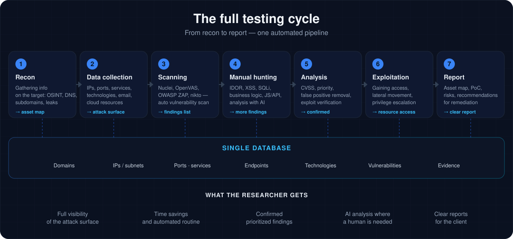
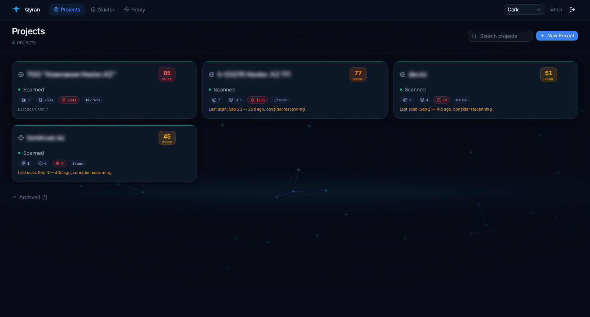
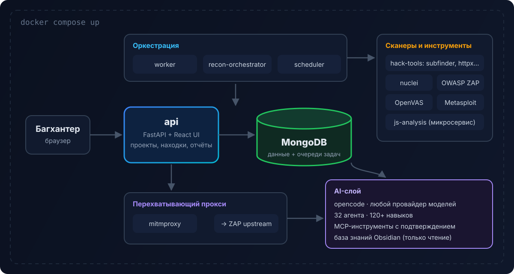
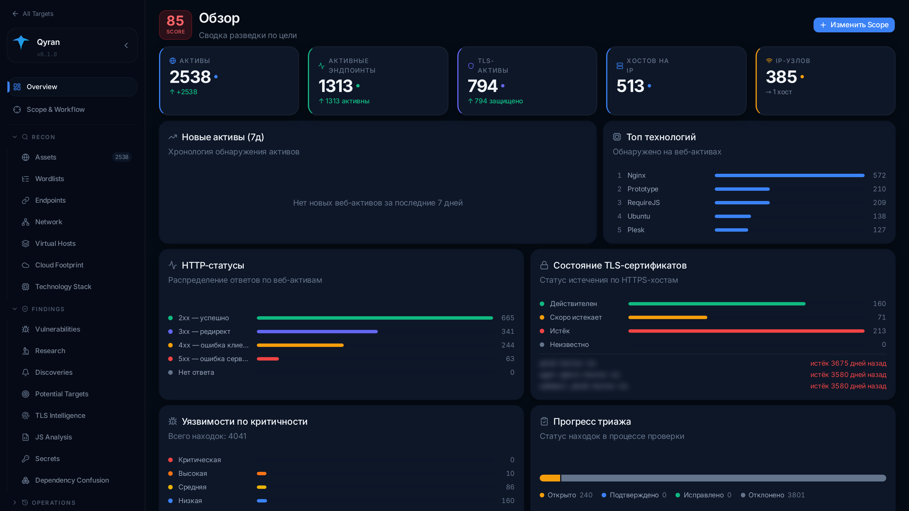
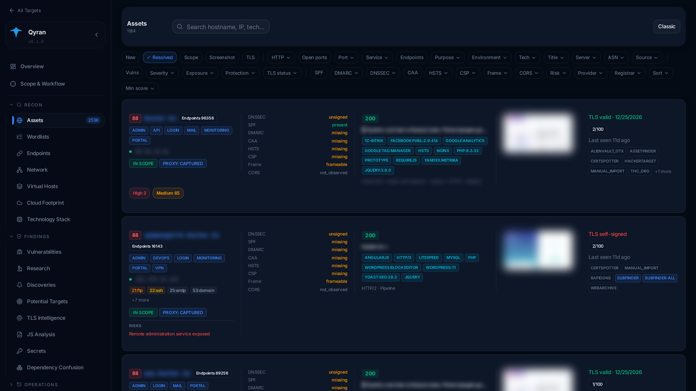
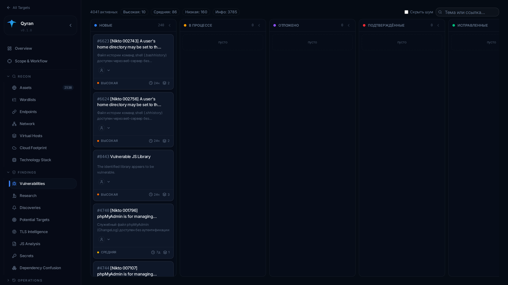
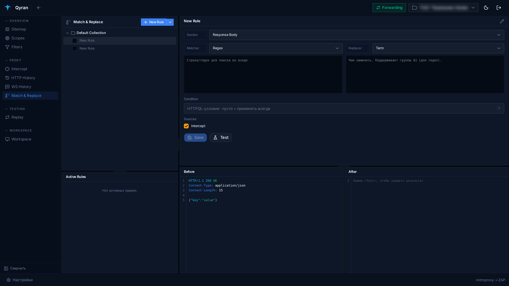
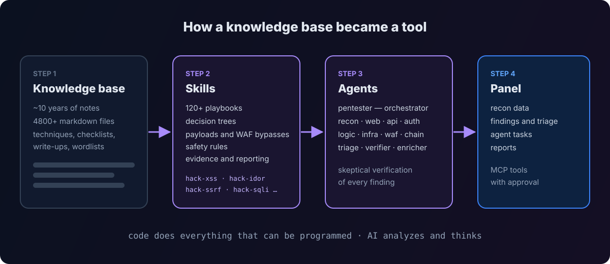

**Qyran** (Kazakh *Қыран* — golden eagle) is my self-hosted platform for bug bounty and security audits. It ties dozens of recon and scanning tools into one process, stores everything in a shared database, shows results in a convenient panel and brings in AI agents where analysis is needed. This article covers why it exists, the attempts that led to it, and how it works inside.

> The source code is closed. All screenshots are taken on real data and anonymized: target names, domains, IP addresses and page previews are blurred.

## The problem: manual recon doesn't scale

Classic recon and auditing means:

- **dozens of tools** — `subfinder`, `httpx`, `nmap`, `ffuf`, `nuclei`, OpenVAS, OWASP ZAP and many more, each for its own job;
- **different output formats** — some tools find what others miss, and part of the results overlap;
- **manual aggregation** — merging, cleaning and comparing results takes hours;
- **the risk of forgetting** — with so many tools, flags and formats it's easy to skip a check or lose an important finding.

Ready-made platforms exist, but serious ones like Faraday are enterprise products with enterprise prices. For a solo researcher or a small team that's out of reach.

## My road to the panel

My path in offensive security went through bug bounty, Hack The Box, PortSwigger labs, Root-Me challenges and my own knowledge base in Obsidian. Over the years it collected thousands of notes: attack techniques, vulnerability write-ups, recon checklists, wordlists.

### First attempt — ReconWTF

My first attempt at automation was **[ReconWTF](/blog/reconwtf/)** (in Russian), a Bash framework that ran 30+ tools in a chain. It worked, but hit a ceiling:

- the results were text files that still had to be parsed by hand;
- no database, no history, no comparison between runs;
- Bash scales poorly — maintaining and extending it became painful.

I archived the project and started thinking about a proper panel.

### The turning point — AI

The decision to build the panel came when I took the XSS hunting methodology from my knowledge base, turned it into a **skill for an AI agent** and pointed it at a PortSwigger lab. The agent found every vulnerability in the lab within minutes — by hand that could have taken hours.

The real discovery wasn't even the speed: **the knowledge base I'd been building for almost ten years finally started working as a tool.** The notes turned not into short hints but into full playbooks: decision trees, safe-operation rules, checklists, payloads, WAF bypass branches, evidence and reporting requirements, and routing between vulnerability classes.

It became clear that with many such skills and all recon data in one database, the result would be a framework for automated vulnerability discovery and analysis.

## Philosophy: code for the routine, AI for analysis

Qyran's core principle:

> **Everything that can be done with code is programmed. AI handles what needs analysis and creativity.**

AI is an important component, but neither the only one nor the main one. Recon, scanning, deduplication, comparison with previous runs and asset scoring are deterministic code. AI receives already prepared data and solves problems that need flexibility: testing a hypothesis, untangling business logic, chaining findings together.

It's also a question of money. Subscriptions to top models cost around $200 a month. The AI layer is built on [opencode](https://opencode.ai), which lets you plug in different model providers and pick by price and quality. In my tests one of the DeepSeek models was the best value — **a full scan costs about one dollar**. I wrote more about this in [Cutting AI agent costs](/en/blog/ai-agent-costs/).

## The full testing cycle



You feed in known targets — domains, subdomains, IP addresses and ranges — and set the scope. Then you wait. Run modes: one-off, daily, or **continuous monitoring**; individual stages can be switched on and off.



## Architecture



Everything starts with a single Docker Compose command:

| Service | Role |
|---|---|
| `api` | FastAPI backend and the built React UI |
| `worker`, `recon-orchestrator`, `recon-stage-dispatcher` | multi-stage recon orchestration |
| `scheduler` | periodic scans and jobs |
| `mongodb` | primary storage **and job queues** |
| `mitmproxy` → `zap` | intercepting proxy and active/passive scanning |
| `openvas`, `hack-tools` | infrastructure scanner and a container with CLI tools |
| `js-analysis` | a separate JavaScript analysis microservice |

Stack: Python 3.12, FastAPI, React + TypeScript + Vite + Tailwind, MongoDB, Docker Compose. The backend is about 67k lines of Python; the whole project is around 150k lines.

An interesting choice is **no Redis and no separate broker**. Queues are MongoDB collections with atomic job claiming: a worker marks a job as its own in a single operation, so two worker replicas never take the same job. Fewer services, simpler deployment.

## The heart of the panel: a signal-driven recon pipeline

The most interesting part under the hood is how recon works. It is not a linear "step 1 → step 2 → step 3" script but a **pipeline driven by signals**.

Each stage is described by a contract:

- which **signals** it consumes;
- which **signals** it produces;
- which stages it depends on;
- its priority.

```text
hostname ──► dns_resolution ──► dns_resolved, ip
dns_resolved ──► http_liveness ──► live_origin
live_origin ──► full_http_metadata ──► technology, certificate
live_origin ──► crawl ──► endpoint, js_source
live_origin ──► proxy_capture ──► proxy_captured
live_origin ──► screenshot ──► screenshot_captured
ip ──► ports_services ──► port, service
hostname ──► historical_urls ──► endpoint, archive_js
endpoint, api_route, parameter ──► wordlist_refresh ──► wordlist_updated
```

Every new finding is a signal. A new subdomain spawns a DNS resolution job, resolution spawns a liveness check, a live host spawns metadata collection, crawling, a screenshot and proxy capture. **The pipeline plans what to do next based on what it has already found.** Inside the project these loops are called Ouroboros — the snake eating its own tail: the output of one cycle becomes the input of the next.

Why this matters:

- **no wasted checks** — a stage runs only when there is data for it;
- **idempotency** — identical signals are merged, so re-runs don't create duplicates;
- **easy to extend** — a new stage is described by a contract and plugs into the graph automatically;
- **continuous mode** — the pipeline can run forever, reacting to changes on the target.

## Panel sections

### Overview — the target at a glance



One screen shows how many assets and live endpoints there are, the top technologies, HTTP status distribution, TLS certificate health (including long-expired ones), vulnerabilities by severity and triage progress.

### Assets — the asset explorer



Each host gets a full picture: purpose (admin, API, login, mail, portal, VPN), DNSSEC and mail records (SPF, DMARC, CAA), security headers (HSTS, CSP, framing protection), technologies and versions, open ports, TLS, the sources the host was discovered from, and identified risks — for example, "a remote administration service is exposed". Dozens of filters let you quickly find, say, every host without HSTS that has an exposed admin panel.

Separate views: **Endpoints** (everything the crawler found), **Network** (IPs, ports, service versions and related domains), **Virtual Hosts**, **Cloud Footprint** (CDNs and cloud providers), **Technology Stack** (where a given technology is used — handy when a new CVE drops) and **TLS Intelligence**.

### Opportunity score — where to dig first

Targets and assets in the screenshots carry a number from 0 to 100. It's an **attractiveness score for the researcher**, and it is fully explainable — it adds up from three capped buckets:

| Bucket | Max | What it considers |
|---|---:|---|
| **Sensitivity** | 40 | how "juicy" the asset is: admin panels, APIs, databases, dev/staging, surface size |
| **Exposure** | 35 | how attackable it is right now: confirmed findings, exposed management and DB ports, secrets in JS, no CDN/WAF, subdomain takeover risk |
| **Hygiene** | 25 | configuration defects: TLS, headers, CORS |

A high score means a weak, reachable, sensitive asset with confirmed findings — the one to look at first. The score is a pure function of the data already collected, so it's recalculated after every scan and always shows **which signals produced it**.

### Vulnerabilities — finding management



Findings from every scanner — nuclei, ZAP, OpenVAS, nikto, JS analysis — land on one kanban board: new, in progress, deferred, confirmed, fixed. Cards have markdown descriptions, subtasks, comments, attachments and assignees. A **"Hide noise"** toggle keeps informational findings out of the way of the important ones.

### Discoveries and Potential Targets

**Discoveries** is a change feed. In monitoring mode the panel compares every run with the previous one: a new subdomain appeared, a port opened, a service response changed. If a firewall "fell" on some subdomain and a service became reachable from outside, you need to see it immediately, not a month later.

**Potential Targets** are assets indirectly related to the target (shared IP, certificate, registrant) that are **not scanned by default**: they may belong to another company. The researcher decides whether they are in scope. Scanning what you're not authorized to scan is off-limits — and the panel enforces that architecturally, not on the honor system.

### A custom intercepting proxy

The panel includes a full intercepting proxy in the spirit of Burp and Caido:

- **Intercept** — pause a request, response or WebSocket message, edit it, then forward or drop it;
- **HTTP and WS History** — all captured traffic with filtering;
- **Replay** — collections and sessions of repeated requests;
- **Scopes and Filters** — saved presets;
- **Sitemap** — a tree of the crawled site.



Two things I did my own way.

**HTTPQL** — a query language for traffic history, like Caido's. Instead of a dozen checkboxes you write a condition like `resp.code.eq:200` and get exactly what you need. The same language is used as the **condition** in Match & Replace rules.

**Match & Replace on a single engine.** The rule engine is written in pure Python standard library with no app dependencies. So *the very same file* is mounted into the mitmproxy container and used by the backend for the "Test" button. Whatever the test shows in the panel is exactly what happens to live traffic. A rule is a section (request/response headers or body), a match type (full replace, substring or regex with `$1` groups) and an optional HTTPQL condition.

Technically traffic flows through mitmproxy with ZAP chained as upstream, so all the traffic a researcher generates by hand also goes through ZAP's passive analysis.

### Nuclei templates

A dedicated section manages nuclei templates. Besides the official library, the panel has its own structure:

- **working** templates — drafts I write and debug;
- **production** templates — verified ones that run in scans;
- **URL templates** — for targeted checks;
- importing templates from GitHub repositories and forking official templates into working ones for changes.

A dedicated AI agent can write a nuclei template for a specific finding and run it straight away — so a manual finding becomes an automated check across all targets.

### JavaScript analysis, secrets and dependency confusion

Modern applications hide half their logic in JavaScript. A separate microservice collects JS files and source maps, keeps their revisions, **shows diffs between versions** and extracts endpoints and parameters. New API routes in a fresh bundle are one of the most underrated entry points.

**Secrets** looks for leaked keys and tokens. Known providers have a **validator**: it makes a single safe **read-only** request to the provider's own API to tell whether a key is live. Requests only go to an allow-list of provider hosts, and user input is never put into the host name.

**Dependency Confusion** pulls npm package names out of the collected JS and checks whether they exist in the public registry. If an internal package name isn't taken publicly, that's a potential dependency substitution attack. The check only talks to the npm registry and the OSV database — **the target itself is never touched**.

For rendering modern JS apps, screenshots and response previews, the panel has a built-in headless browser with separate profiles.

### Reports, history and settings

- **Reports** — report preview and PDF export;
- **Scan History** — logs and history of every run;
- **Tool Control** — fine-tuning tools right from the UI: rate limits, threads, timeouts, headers, port profiles;
- **Test Accounts** — storage for test accounts used in authorized testing.

## The AI layer



### Knowledge base → skills

The Obsidian vault — **4,800+ markdown notes** — is mounted into the containers read-only. It was turned into **120+ skills**, most of them `hack-*` skills by vulnerability class and technique: web injections, authentication and access control, business logic, APIs, Active Directory, cloud, mobile apps, containers and more. A skill isn't a "find XSS" prompt but a playbook the agent loads for the task at hand.

### Agents

32 specialized agents. The main one, `pentester`, is the orchestrator: recon → task delegation → assembling findings. Under it are specialists by area — recon, API, web, authentication, business logic and IDOR, infrastructure, WAF bypass, attack chains. And a separate group that makes results trustworthy:

- **triage** — reviewing and prioritizing findings;
- **verifier** — **skeptical re-verification**: an agent that tries to prove a finding is false;
- **enricher** — adding CVSS, CWE, CVE and remediation advice.

Another group of agents works on the platform and the knowledge base themselves — from architecture and tests to creating new skills.

### Autonomous shifts and control

The most dangerous thing about autonomous AI is that it does the wrong thing or burns the budget. So autonomous work has hard limits:

- **shifts** — time- and budget-limited testing sessions; when the deadline or cost limit is reached, the shift stops and hands over;
- **safety rules** are embedded into every shift's brief;
- a **watchdog** monitors autonomous agents and cleans up if something goes wrong;
- **action approval** — agent tools are connected via MCP, and potentially risky actions require confirmation. The auto-approval policy is configured globally and per schedule;
- **scope checks** at the tool level — an agent can't step outside the authorized scope;
- a **coverage log** — which checks were completed, partially done, failed or skipped. You see not only what was found but also **what hasn't been checked yet**.

## Responsible use

Qyran is a tool for **authorized** testing: bug bounty programs within their rules and contracted audits. So the panel has architecture-level guardrails:

- explicit **In Scope** and **Out of Scope** for every project;
- indirectly related assets go to Potential Targets and **are not scanned** until the researcher decides;
- secret and dependency checks never touch the target;
- risky agent actions require confirmation.

## What's next

- more skills and specialist agents;
- deeper continuous recon: AI hypotheses that the pipeline tests on its own;
- reports tailored to bug bounty platform formats.

For me Qyran is the main outcome of many years in security: the knowledge base I've been building since school became a working tool, and the recon routine became a pipeline that runs while I sleep.

The code is closed, but I'm happy to demo the panel live — [message me](https://t.me/solo10010). I write about Qyran's defensive "sibling", a vulnerability triage panel for SOC, in [Building a SOC on Wazuh from scratch](/en/blog/wazuh-soc-from-scratch/).
