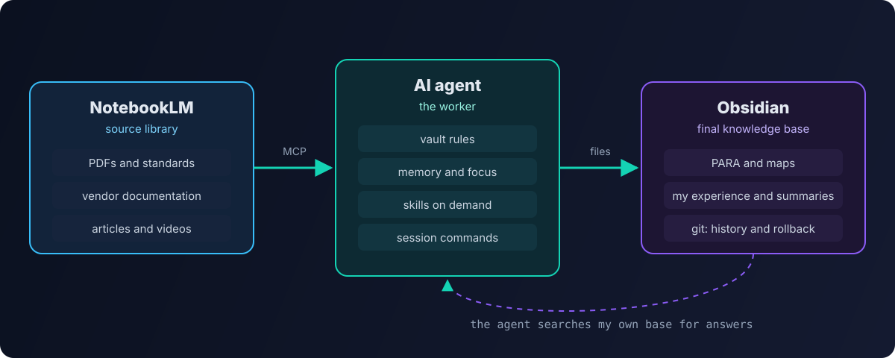
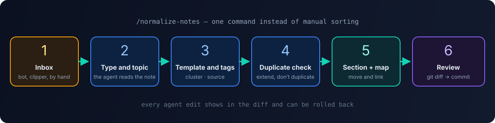

I described how the vault itself is organized in [How I organized my notes in Obsidian: PARA](/en/blog/obsidian-para/). This is the next step: how AI tools are connected to it and what work they took over.

## The problem: writing is easy, sorting isn't

I got used to writing in Obsidian long ago. The bottleneck was elsewhere:

- the inbox fills up faster than I can sort it;
- notes of different ages are formatted differently;
- to answer "how did I do this before" you have to remember where the note is;
- every new AI chat starts from zero — you have to explain the context again.

## Three roles

The solution is to split the work between tools and give each one a single role.

| Tool | Role | What it does |
|---|---|---|
| **NotebookLM** | source library | keeps raw materials — PDFs, documentation, long articles, videos; answers strictly from them, with citations |
| **AI agent** (Claude Code, opencode) | worker | reads and writes vault files, sorts the inbox, turns sources into notes |
| **Obsidian** | final knowledge base | only verified, formatted knowledge in my own structure |

The key principle: **raw and processed don't mix**. A two-hundred-page standard or vendor documentation lives in NotebookLM — it's convenient to ask questions about the original source there. Only the essence goes into Obsidian: "what I need from it and how I applied it".

## The agent works directly with files

An Obsidian vault is just a folder of markdown files. The agent doesn't need any API: it opens the folder as a project and works with the files directly. For external sources such as NotebookLM or a browser, **MCP servers** are connected — the standard way to give an agent tools.

To keep the agent from turning the vault into a dump, its configuration lives at the vault root.

### Vault rules

An instruction file the agent reads at the start of every session: the PARA folder structure, the tagging system, the map format, where to put different types of notes and **what not to do** — for example, deleting notes or touching the archive without confirmation.

### Memory

The agent doesn't remember past sessions, so memory is files:

- **long-term memory** — a short file with key facts: what I'm working on, which decisions were made, which conventions apply. It has a hard size limit of a few thousand characters. Without a limit, memory bloats and starts costing money in every request;
- **current focus** — what I'm working on this week;
- **session summaries** — after every session the agent writes a short summary: what was done, what was decided, what's left.

A session start command loads the memory and focus; a session end command writes the summary and updates memory. A new chat no longer starts from zero.

### Skills

A **skill** is an instruction for a specific type of task that the agent loads only when needed. I have two kinds of skills:

- **utility** — note normalization, working with the vault, memory sync, creating new skills;
- **domain** — what I do at work: bug bounty, server security audits, an Active Directory advisor, a Wazuh cluster advisor.

Domain skills rely on my own knowledge base: the AD advisor knows my CIS Benchmark notes and [my rollout](/en/blog/active-directory-cis-benchmark/), so it answers in the context of my infrastructure rather than with generic advice from the internet.

## The inbox pipeline

The most useful automation is sorting the inbox.

1. A note lands in the **Inbox** — from a Telegram bot, a web clipper or by hand.
2. The normalization command: the agent reads the note and identifies its type and topic.
3. It applies the template: title, properties, `cluster/…` and `source/…` tags.
4. It looks for similar notes — **extending an existing note beats creating a duplicate**.
5. It moves the note to the right section and adds a link to the section map.
6. I review the changes as a git diff and confirm.

Step six matters: the vault lives in git, so any change the agent makes can be reviewed and rolled back. **I trust the agent exactly as much as I can review and undo its work.**

## What works and what doesn't

**Works great:**

- normalizing and sorting the inbox — saves hours a week;
- searching "how did I do this before" across the whole base;
- merging several notes into one structured note;
- drafting — including the articles on this blog, which grew out of my notes.

**Works poorly or needs supervision:**

- the agent tends to "improve" wording — unnecessary for personal notes, so rules have to restrain it;
- without limits, memory and rules grow and every request gets more expensive;
- private notes can't be given to a cloud model — that's what a [local LLM](/en/blog/ollama-open-webui/) is for.

On money specifically — I covered how not to overspend on agents in [Cutting AI agent costs](/en/blog/ai-agent-costs/).

## Summary

A "second brain" isn't one magic program but a division of roles:

- **NotebookLM** remembers the sources;
- the **agent** does the routine by rules and skills;
- **Obsidian** keeps knowledge in my structure;
- **git** guarantees nothing gets lost.

Tools alone don't make a knowledge base useful. Structure does — and the regularity that the agent now maintains.
